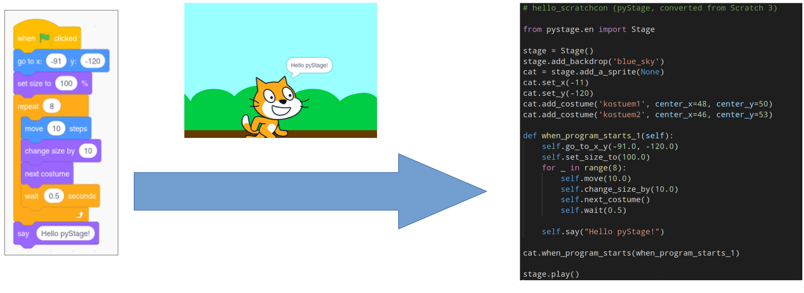

# PyStage

[](https://pystage.readthedocs.io/en/latest/?badge=latest)

Scratch-like Python programming.

PyStage bridges the gap between [Scratch](https://scratch.mit.edu/) and Python. This module implements all code blocks
as available in scratch. With the PyStage command line converter Scratch projects can be easily
transferred to Python executable Code. To run your game in Python, PyStage uses [pygame-ce](https://pyga.me/), the community edition of PyGame.



## Demo

Consider the following code. It defines a stage and a sprite on the stage. The functions are code blocks that are associated with events (i.e. connected to a hat block in Scratch) via the corresponding methods.

```python
from pystage.en import Stage

stage = Stage()
stage.add_backdrop("grid")
zombie = stage.add_a_sprite()

def doit(zombie):
    zombie.say("Hello pyStage!")
    for i in range(4):
        zombie.move(10)
        zombie.wait(1)
        zombie.think("This is awesome!")
        zombie.turn_left(90)
        zombie.wait(1)
        zombie.think("")
    zombie.say("Move me around with WASD.")

zombie.when_program_starts(doit)

def right(zombie):
    zombie.change_x_by(10)

def left(zombie):
    zombie.change_x_by(-10)

def up(zombie):
    zombie.change_y_by(10)

def down(zombie):
    zombie.change_y_by(-10)

zombie.when_key_pressed("d", right)
zombie.when_key_pressed("a", left)
zombie.when_key_pressed("w", up)
zombie.when_key_pressed("s", down)

stage.play()

```

And here is the result:


## Goals
* Export your Scratch project to real executable Python code!
* Helping coding beginners to learn Python "by Scratch".
* Implementation of scratch blocks in several languages (ideal for kids). As of now en and de.


[](https://www.youtube.com/watch?v=Bo3kUF9k0Vg)

[See our quick intro to PyStage for ScratchCon 2021](https://www.youtube.com/watch?v=Bo3kUF9k0Vg)


# Installation
```pip install pystage```

PyStage needs Python 3.10 or newer. [pygame-ce](https://pyga.me/) is installed automatically. It cannot be installed alongside classic `pygame`, so if you have that installed, uninstall it first: `pip uninstall pygame`.

# Getting started

If you are interested in PyStage and want to get in touch, feel free to join us on our [Discord Server](https://discord.gg/MSGrs3UCCz).

Currently, only the English API is fully translated, the German API is automatically generated. All other languages will be added when PyStage gets more stable. Get in touch if you want to help maintain a translation.

### Deutsch

Die deutsche API heißt `pystage.de`. Auch die Werte aus den Auswahlmenüs von Scratch kannst du auf Deutsch angeben (Groß- und Kleinschreibung ist egal, die englischen Werte funktionieren weiterhin), und Fehlermeldungen und Hinweise erscheinen auf Deutsch:

```python
from pystage.de import Bühne, Figur

bühne = Bühne(titel="Mein erstes Spiel")
zombie = bühne.füge_eine_figur_hinzu()

def nach_oben(zombie: Figur):
    zombie.ändere_y_um(10)

zombie.wenn_taste_gedrückt_wird("Pfeil nach oben", nach_oben)
zombie.wenn_taste_gedrückt_wird("Leertaste", nach_oben)
bühne.abspielen()
```

Weitere Werte: `"beliebiges"` (Taste), `"letztes"`, `"zufälliges"` und `"alles"` bei Listen, `"Betrag"`, `"abrunden"`, `"aufrunden"`, `"Wurzel"` bei der mathematischen Funktion, `"nächstes Bühnenbild"`, `"Mauszeiger"`, `"Rand"`, `"mir selbst"`.

For the English API, you can start with the following example code:

```python
from pystage.en import Sprite, Stage

stage = Stage()
zombie = stage.add_a_sprite()

def doit(zombie: Sprite):
    for i in range(4):
        zombie.move(10)
        zombie.turn_left(90)
        zombie.wait(1)

zombie.when_program_starts(doit)

stage.play()
```

Use the autocompletion of your editor to see what methods are available. There are methods for all Scratch blocks bound to your stage and sprite instances, including the Pen extension, variables, lists, clones and all events. The only blocks that do nothing are the ones that need a microphone (loudness).

Some things work differently than in normal Python programs, because your code behaves like a Scratch script:

* The screen is refreshed after each iteration of a loop and after blocks that take time, like `wait`. You do not have to care about a game loop.
* Like in Scratch, a sprite can never leave the stage completely (at least 15 pixels of it stay visible); set `stage._core.fencing = False` if your game needs sprites fully off the stage.
* Functions in the same file that you call from your code behave like custom blocks in Scratch, i.e. they can contain loops and `wait` as well:

```python
from pystage.en import Sprite, Stage, no_refresh

stage = Stage()
zombie = stage.add_a_sprite()

def jump(zombie: Sprite, height):
    for i in range(10):
        zombie.change_y_by(height / 10)
    for i in range(10):
        zombie.change_y_by(-height / 10)

@no_refresh
def draw_square(zombie: Sprite):
    # Like "run without screen refresh" in Scratch:
    # The square is there at once.
    zombie.pen_down()
    for i in range(4):
        zombie.move(50)
        zombie.turn_left(90)
    zombie.pen_up()

def doit(zombie: Sprite):
    draw_square(zombie)
    while True:
        jump(zombie, 80)
        zombie.wait(1)

zombie.when_program_starts(doit)

stage.play()
```

* If there is an error in your code, the message is shown in the window and in the terminal.

The documentation is here: https://pystage.readthedocs.io/en/latest/pystage.en.html

---

**NOTE**

Please note this is an alpha version. Not all things may work as expected. If so, please contact us or open an issue. Documentation is automatically generated but especially the user-facing block API is still mostly empty.

---

# Import your Scratch projects

## Use our Web converter
1. Publish your Scratch project **or** download your Scratch project as .sb3 file.
2. Go to https://convert.pystage.org and convert your project.
3. Download the resulting zip file, it contains your new Python project ready to run.

## Convert on your computer
Converting a Scratch project to Python code:
1. Export your Scratch project on the Scratch page. You will get an .sb3 file.
2. Use our command line converter. Yes, it's unhandy, we will work on it to make things easier.

The base usage is ```python -m pystage.convert.sb3 <SB3 File> -l en -d <DIRECTORY>```
The parameters are:
* ```-l``` language of generated python "scratch blocks". In the moment of writing, ```en``` and ```de``` are available. Without it, the language neutral core API is used.
* ```-d``` the output directory, defaults to current directory
* ```-i``` print intermediate code representation
* ```-s``` print sb3 project.json
* ```-p``` print python code
* ```-v``` verbose
* ```-vv``` debug mode

Scripts, custom blocks, variables, lists, monitors and comments of your project are converted. Blocks from extensions other than Pen (e.g. Music or Text to Speech) are not supported; they show up as a text starting with `NOT SUPPORTED` in the Python code.


# Fonts and licences

PyStage is MIT licensed. It bundles the original Scratch 3 text fonts (Noto Sans, Source Serif Pro, Handlee, Knewave and Griffy, all under the SIL Open Font License 1.1) so that text in SVG costumes looks like in Scratch, and Roboto (Apache License 2.0) as fallback; see `THIRD-PARTY-NOTICES.md`.


# Contributors

* Kai Eckert, Stuttgart Media University
* Florian Rupp, Stuttgart Media University
